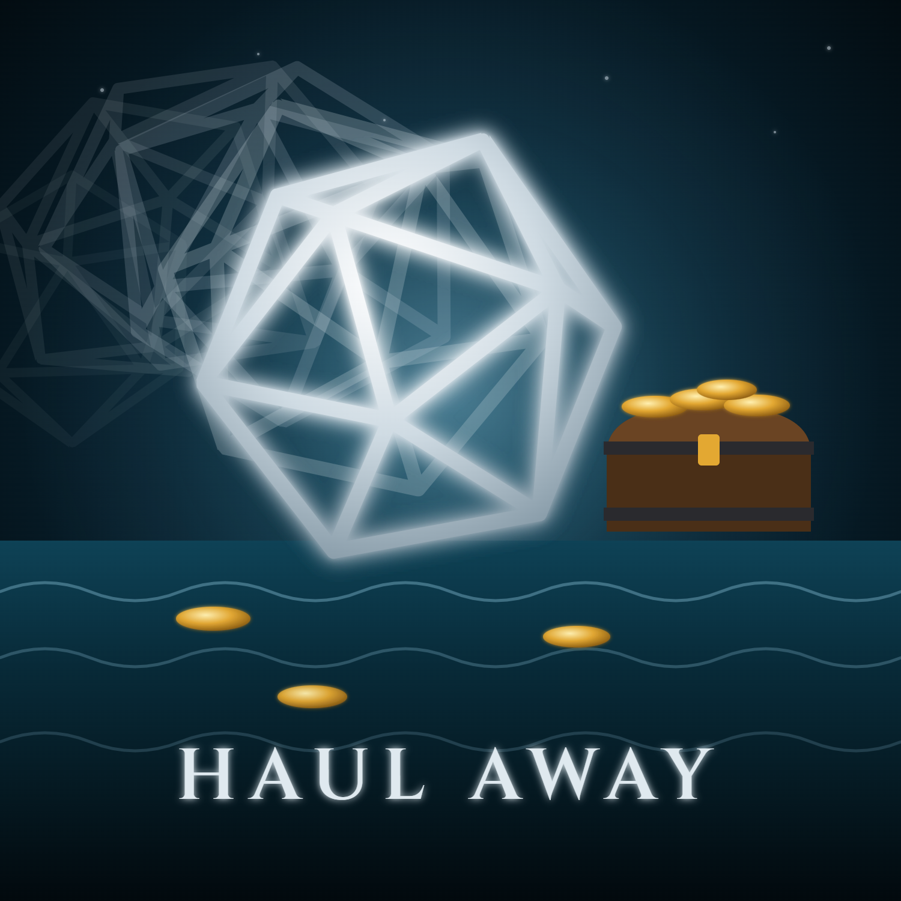

# Haul Away -DnDGen.TreasureGen Theme-

[](https://suno.com/s/1srFPYgfd6VuVpzh)

The DnDGen.TreasureGen theme song: a pirate sea shanty for the treasure hunt, where a shantyman calls out the loot and the crew hauls it aboard.
Its lyrics come from the [DnDGen.TreasureGen README](https://github.com/DnDGen/DnDGen.TreasureGen/blob/main/README.md), sung in plain English,
and the ship they haul it aboard is the *Argenteus Re*, TreasureGen's leitmotif from the [DnDGen main theme](https://github.com/DnDGen/.github/blob/main/theme-song/README.md).

**Listen on [Suno](https://suno.com/s/1srFPYgfd6VuVpzh).**

## Updating

This song follows the [DnDGen.TreasureGen README](https://github.com/DnDGen/DnDGen.TreasureGen/blob/main/README.md).
Every pull request that changes the README gets a song check:

1. If the change rewords or removes a phrase in the Sources table below, the song needs updating.
   The tests catch this one: they fail and list every quoted phrase that is no longer in the README.
2. Otherwise, if the change alters the README's high-level ideas or vibe, the song needs updating.
3. Otherwise, it doesn't. Changes to the README's Theme Song badge or section never need a song update.

When the song needs updating, it happens in the same pull request:

1. The contributor updates the Lyrics and Sources here to match the new README.
   Names are sung as words, never as code.
2. The maintainer makes the new song in Suno:
   - **Cover the current song**, so the theme stays recognizably the same song as it evolves.
   - Use the Title, Style, and Lyrics from this page. **Leave the Style as it is**: only the lyrics change.
   - **Turn Variety all the way down**, so Suno keeps to the Style instead of straying from it.
   - Pick the take. The new take replaces the old one.
   - **Publish it**, so anyone with the link can find and hear it.
3. The maintainer updates the Suno link here and in the README, and adds anything learned to the Suno Notes.

## Title

```
Haul Away -DnDGen.TreasureGen Theme-
```

## Style

```
Traditional sea shanty, a steady two-beat work song for hauling rope. In every verse and chorus a weathered, warm tenor shantyman sings each line clearly and a big crew of sailors sings the answer to it, together on the beat, call and response line after line all the way through. Stamping boots and hand claps for percussion, a wheezy squeezebox, a tin whistle, a fiddle, and a ship's bell. Verses call and answer, choruses swell with the whole crew singing as one, a slower bridge where the crew answers in low murmurs, then a key change into a final chorus with every sailor on the rope. Close, rowdy, warm, live-in-the-room, recorded on a creaking wooden deck at sea.
```

## Lyrics

```
[Intro - a lone squeezebox, a stamping boot, and a ship's bell, then the shantyman sings the call and the crew sings the answer]
Welcome aboard the Argenteus Re!
Let's generate some loot to haul away
— Haul away!

[Verse 1 - the shantyman sings each call and the whole crew sings the answer, together, hauling on the beat]
Generate random treasure, equipment, and items galore
Coins, goods, gems and art, haul them to the shore
— Haul away!
Levels start at one, and run to twenty
Thirty for epic, and that's plenty
— Haul away!

[Chorus - the shantyman sings the call and the whole crew sings the answer, big and warm]
Haul away, haul away!
— Haul away!
Aboard the Argenteus Re
— Argenteus Re!
The coins, goods, and items in the spray
— In the spray!
Name what you want, and haul away
— Haul away!

[Verse 2 - the shantyman sings each call and the whole crew sings the answer, together, hauling on the beat]
Mundane, Minor, Medium, and Major
Pick a power, my brave sailor
— Haul away!
Armor, weapons, tools, potions, rings
Rods, scrolls, staffs, wands, and wondrous things
— Haul away!

[Chorus - the shantyman sings the call and the whole crew sings the answer, big and warm]
Haul away, haul away!
— Haul away!
Aboard the Argenteus Re
— Argenteus Re!
The coins, goods, and items in the spray
— In the spray!
Name what you want, and haul away
— Haul away!

[Verse 3 - the shantyman sings each call and the whole crew sings the answer, together, hauling on the beat]
Magical bonuses, special abilities, too
Curses, and intelligent items to see you through
— Haul away!
To get a specific item, name it, mate
Add any traits, special materials, straight
— Haul away!

[Bridge - slower and low, the shantyman sings each call and the crew sings the answer in a murmur]
Ninject loads the ship
— Ninject!
Dice are rolled, every pip
— RollGen!
Infrastructure fetches tables
— Infrastructure!
Badge confirms the build is stable
— GitHub Actions!

[Verse 4 - building back up, the shantyman sings each call and the whole crew sings the answer, together, hauling on the beat]
Version thirteen and later need dot net ten
Install it via the NuGet Package Manager, then
— Haul away!
So many constants that name what you can make
So much loot to plunder, so grab what you can take!
— Haul away!

[Final Chorus - key change, the shantyman sings the call and the whole crew sings the answer, every sailor on the rope]
Haul away, haul away!
— Haul away!
Aboard the Argenteus Re
— Argenteus Re!
The coins, goods, and items in the spray
— In the spray!
Name what you want, and haul away
— Haul away!

[Outro - the crew slows and fades, the shantyman sings the call and the crew sings the answer, a squeezebox and a ship's bell]
Haul away, haul away
— Haul away
[A last bell rings across the water]
```

The *Argenteus Re* is the ship. Its name is Latin for "silver in substance", TreasureGen's leitmotif from the main theme, so the leitmotif is the name the crew sings back, and the song is named for the work call they sing most.

## Sources

| Lyric | From the README |
|---|---|
| Welcome aboard the Argenteus Re! | Not from the README: the welcome, naming the ship, TreasureGen's leitmotif from the DnDGen main theme |
| Let's generate some loot to haul away | Introduction: "Generate random Dungeons & Dragons treasure" |
| — Haul away! | Not from the README: the crew's answer, the shanty's work call and the song's title |
| Generate random treasure, equipment, and items galore | Introduction: "Generate random Dungeons & Dragons treasure, equipment, and items" |
| Coins, goods, gems and art, haul them to the shore | Introduction: "coins, goods (gems and art), and items" |
| Levels start at one, and run to twenty | Use: "Levels start at 1" and "run to 20 for standard treasure" |
| Thirty for epic, and that's plenty | Use: "to 30 for epic treasure" |
| Haul away, haul away! | Not from the README: the shanty's work call and the song's title |
| Aboard the Argenteus Re<br>— Argenteus Re! | Not from the README: TreasureGen's leitmotif from the DnDGen main theme, Latin for silver in substance, as the name of the ship |
| The coins, goods, and items in the spray<br>— In the spray! | Use: "the coins, goods, and items of a treasure" |
| Name what you want, and haul away | Use: "To get a specific item, name it" |
| Mundane, Minor, Medium, and Major | Use: "Item powers are Mundane, Minor, Medium, and Major" |
| Pick a power, my brave sailor | Use: "Item powers are Mundane, Minor, Medium, and Major" |
| Armor, weapons, tools, potions, rings | Introduction: "armor, weapons, tools, potions, rings, rods, scrolls, staffs, wands, and wondrous items" |
| Rods, scrolls, staffs, wands, and wondrous things | Introduction: "armor, weapons, tools, potions, rings, rods, scrolls, staffs, wands, and wondrous items" |
| Magical bonuses, special abilities, too<br>Curses, and intelligent items to see you through | Introduction: "including magical bonuses, special abilities, curses, and intelligent items" |
| To get a specific item, name it, mate | Use: "To get a specific item, name it" |
| Add any traits, special materials, straight | Use: "with any traits (such as a special material)" |
| Ninject loads the ship<br>— Ninject! | Getting the Generators: "You can obtain generators via the Ninject module" |
| Dice are rolled, every pip<br>— RollGen! | Getting the Generators: "including RollGen and Infrastructure" |
| Infrastructure fetches tables<br>— Infrastructure! | Getting the Generators: "including RollGen and Infrastructure" |
| Badge confirms the build is stable<br>— GitHub Actions! | Build badge: "Build Status" and "actions/workflows/release.yml", the GitHub Actions workflow the badge reports |
| Version thirteen and later need dot net ten | Installing: "Version 13 and later need .NET 10" |
| Install it via the NuGet Package Manager, then | Installing: "Install via the NuGet Package Manager" |
| So many constants that name what you can make<br>So much loot to plunder, so grab what you can take! | Use: "using the constants in the Constants table below" |
| Haul away, haul away<br>— Haul away | Not from the README: the shanty's work call and the song's title |

## Suno Notes

Drafts so far, and what is still untested:

- **Drafts and the Sample.** Every draft before this song first merges is a fresh generation that
  Samples the main theme's "Rogante Marendor" snippet (3:00.0 to 3:17.1) with Variety all the way
  down, per the main theme's
  [New Theme Songs](https://github.com/DnDGen/.github/blob/main/theme-song/README.md#new-theme-songs).
  The take that merges is v1; every update from there Covers it.
  The first two takes were generated without the Sample by mistake, and both were very good, so
  the unsampled shanty stands well on its own and the maintainer almost prefers it. The sampled
  takes followed. In one, the tin whistle plays the Rogante Marendor theme well, and the orchestra
  that creeps in comes across as fiddle or an epic sailor song (think Klaus Badelt's Pirates of the
  Caribbean score), which suits a shanty about treasure, so that kind of take is a keeper.
- **The crew's answers are ordinary lines, not parentheses.** Infrastructure's drafts lost almost
  every parenthesized echo and got the second voice only once it was sung as an ordinary line, with
  the voices assigned in each section's tag and the Style, no inline voice tags, and an em dash before
  each answer for the reader. This draft does the same. The Argenteus Re answers are in
  that form too.
- **Rhyme.** Verses are written in couplets (shore/galore, twenty/plenty, rings/things, too/through,
  ten/then, make/take), and the chorus rhymes "Re", "spray", and "away". The bridge rhymes too
  (ship/slip, hold/told). Some lines are the README's phrase with a few words added to rhyme ("galore",
  "and that's plenty", "straight"), and the Sources rows quote only the README part.
- **The singer is a guess.** A "weathered, warm tenor" is named because RollGen's lesson was to name
  the singer, and a raspy baritone came out growly there. "Weathered" may still pull it gravelly.
- **The Sample pulls toward the orchestra.** The Style names a squeezebox, tin whistle, and fiddle
  to counter it, as Web's Kit Kat band did. Naming instruments is fine here: Infrastructure's
  lesson against it was for an a cappella song, where naming an instrument to "bound" the sound fed
  the orchestra. This shanty wants the band, so name it. The sampled takes still brought the orchestra
  in, but as fiddle and sea-adventure strings rather than a choir, which the song can carry.
- **Length: 3:12.** The takes ran fast, about 2,830 characters of lyrics in 3:12, roughly 880
  characters a minute, nearly double the 460 of slow chant I guessed from. That run also had the
  Rogante Marendor instrumental snippets, a repeated final chorus, and an extra bass "Haul away"
  growl at the very end, none of which are in the lyrics, so the true sung rate is higher still.
  For a shanty, budget about 900 characters a minute or more.
- **"Dot net ten"** is spelled out so Suno doesn't read ".NET" as a symbol; RollGen's song sang
  ".NET ten".

## Album Art

[cover.png](cover.png) is rendered from [cover.html](cover.html), which you can open in any browser.
To render it again at 1500 × 1500, from this folder:

```
msedge --headless --hide-scrollbars --allow-file-access-from-files --window-size=1500,1500 --screenshot=cover.png cover.html
```

If Edge reads `cover.html` as a web address, pass it as a full `file:///` URL instead.

- It is the main theme's [cover](https://github.com/DnDGen/.github/blob/main/theme-song/cover.html), recoloured for the sea.
  The d20 is silver, for the *Argenteus Re*, and the ghost copies behind it are its tumble
  toward a chest of coins on the horizon. The title is the song's, *Haul Away*.
- The d20 is the dndgen.com loading spinner, from [DnDGen.Web](https://github.com/DnDGen/DnDGen.Web/blob/main/dndgen-web/src/assets/loadingDice.svg), originally from [a gist by hperantunes](https://gist.github.com/hperantunes/f4c2fd407c2ea74c6c9d).
- The title is set in [Cinzel](https://github.com/NDISCOVER/Cinzel), included as [Cinzel.ttf](Cinzel.ttf) under the [SIL Open Font License](Cinzel-OFL.txt).
